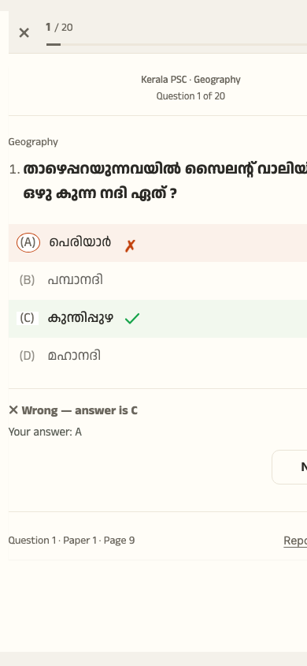
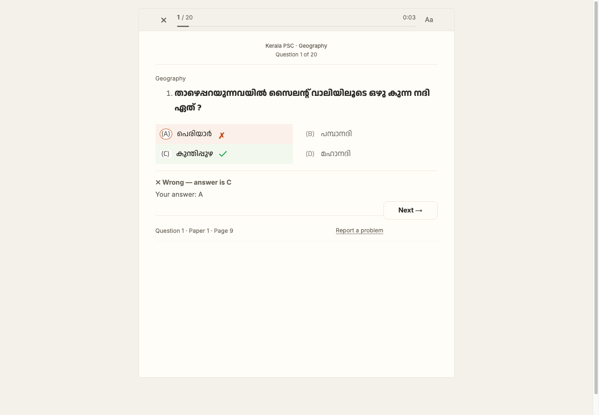

# Step 8 — Real paper look

## Current captures

The captures show the wrong-answer state in Cream. The mobile capture is 390 × 844; the desktop capture is 1440 × 1000.

## Contrast check

Ratios use the specified colors, rounded to two decimals. All tested normal-text pairs exceed WCAG AA's 4.5:1 threshold.

| Tone | Ink / paper | Secondary ink / paper | Correct mark / tint | Wrong mark / tint |
|---|---:|---:|---:|---:|
| White | 15.81:1 | 5.93:1 | 4.70:1 | 4.74:1 |
| Cream | 14.12:1 | 5.54:1 | 4.64:1 | 4.65:1 |
| Night | 12.93:1 | 6.64:1 | 9.06:1 | 7.26:1 |

No token adjustments were needed.

## Coverage still needed

The production build passes. This report does not yet contain the full requested screenshot matrix (all answer states, OMR panel, all tones, sizes and viewport widths). The mobile capture also shows the right edge of some controls clipped, so the phone layout needs another visual pass before release. Profile synchronization for reading settings and a clear-selection action in the mock OMR flow are also outstanding.
